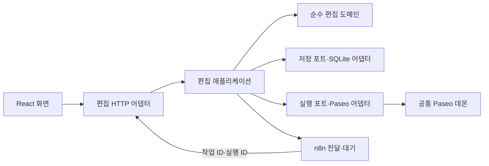

# C2 · 실행·저장

- runtime 조립 진입점이 하나의 Node 애플리케이션에 모듈과 포트를 연결 · ARCH-001·ADR-0004
- n8n은 별도 도구 프로세스 · 편집 정책·예산·상태 전이 코드를 포함하지 않음
- 저장: `.local/ai-runtime/` · n8n `.local/n8n/` · 다른 제품 저장소 참조 없음
- Paseo 설치·인증·세션은 공통 도구 소유 · 프로젝트 원문·작업 기록은 AIN 소유
- 검증: 별도 포트·임시 SQLite·합성 데이터 · fixture와 실제 모델 분리
