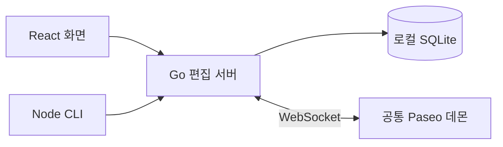

# C2 · 실행·저장

- Go 서버는 React 빌드 자산, HTTP·SSE, 편집 실행기와 SQLite를 묶는다(ARCH-001, ADR-0031).
- 공통 Paseo는 제공자 인증과 모델 실행을 맡는다. AIN은 자신의 SQLite와 작업 파일을 관리하며 공통 데몬의 생명주기를 소유하지 않는다.
- Node CLI는 로컬 HTTP 계약을 사용한다. 이전 n8n 실행 이력은 비공개로 보존한다(OPS-002).
- 검증 환경에서는 별도 루프백 포트, 임시 데이터, 합성 제공자를 사용한다.
