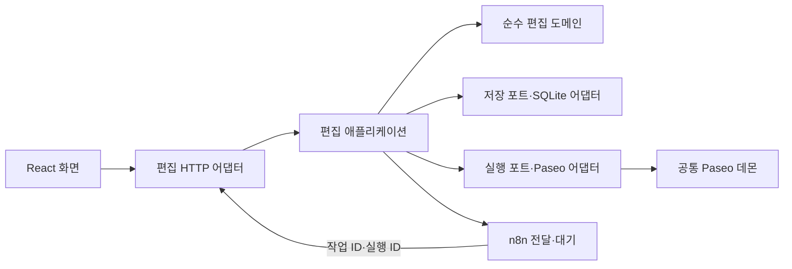

# C2 · 실행·저장

- 애플리케이션 조립: runtime 조립 진입점이 하나의 Node 애플리케이션에 모듈과 포트를 연결한다(ARCH-001·ADR-0004).
- n8n 분리: n8n은 별도 도구 프로세스로 동작하며, 편집 정책·예산·상태 전이 코드를 포함하지 않는다.
- 저장 위치: 애플리케이션 데이터는 `.local/ai-runtime/`에, n8n 데이터는 `.local/n8n/`에 저장하며, 다른 제품의 저장소는 참조하지 않는다.
- 소유 구분: Paseo의 설치·인증·세션은 공통 도구가 맡고, 프로젝트 원문과 작업 기록은 AIN이 관리한다.
- 검증 환경: 별도 포트, 임시 SQLite, 합성 데이터를 사용하며, fixture 검증과 실제 모델 실행을 분리한다.
